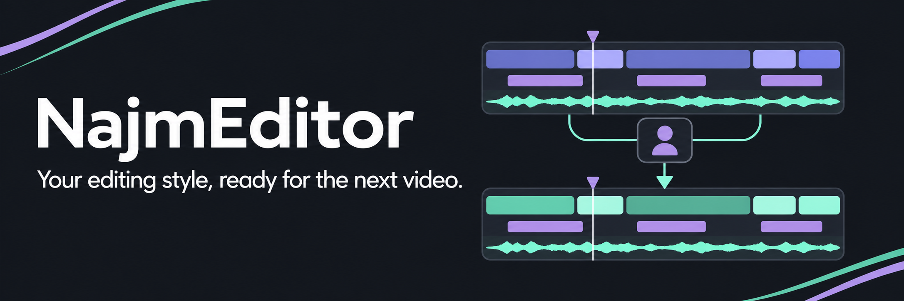
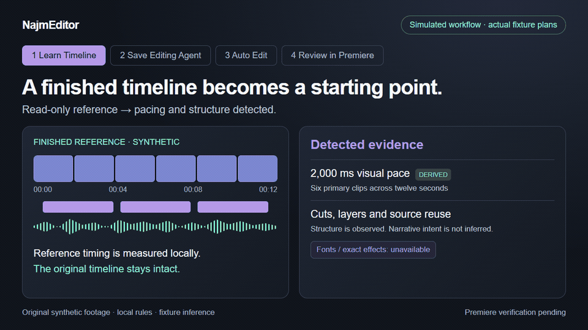
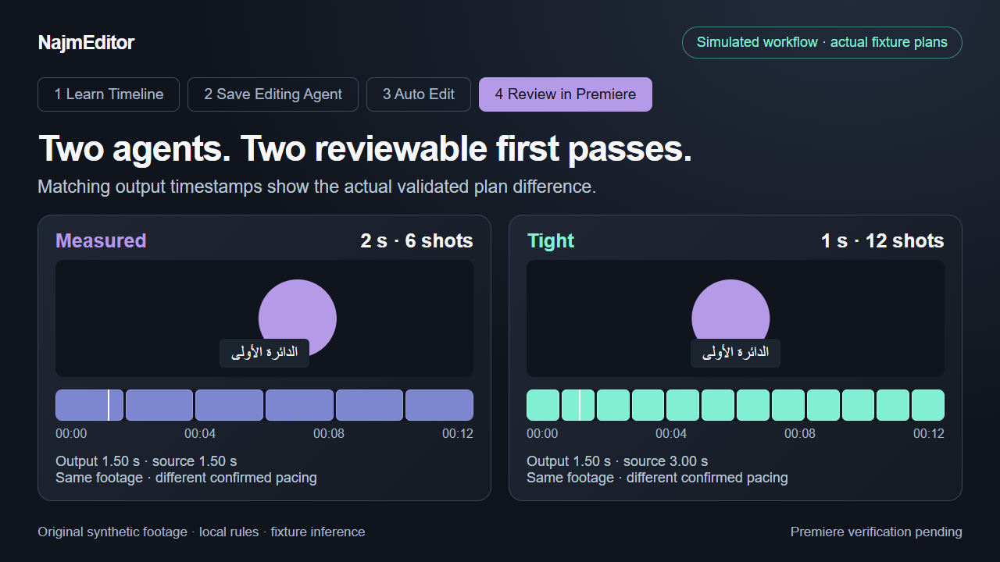
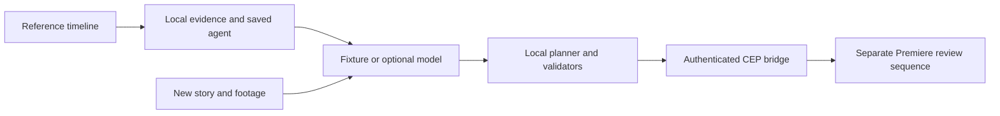

# NajmEditor

**Your editing style, ready for the next video.**
NajmEditor reads a finished Premiere Pro timeline and saves supported reusable editing patterns as an agent. Choose that agent for new footage to plan a separate first pass you can review and refine in Premiere. Save a different agent for each client or series.

**Developer preview · Simulated workflow below; real Premiere acceptance is pending.**



[Watch/download the 20-second MP4](docs/media/workflow.mp4) · [Inspect the actual fixture plans](docs/media/agent-comparison.json)

The walkthrough uses actual V2 fixture output, original synthetic footage and generic agents. It is an animated explainer, not a recording of Premiere. No private styles, client projects, fonts or native templates are included.

I built NajmEditor around a recurring editing problem: each client or series already has a look and pace, but transcription, captions, titles and similar timeline decisions have to be rebuilt for every video. A finished edit should be a useful starting point for the next one. The editor keeps the final creative decision.

## Same footage, two editing agents



| Saved generic agent | Confirmed pacing rule | Second visible rule | Validated first pass |
|---|---|---|---|
| **Measured** | 2-second visual pace — executable | 2-second opening pace — advisory | 6 shots / 12 seconds |
| **Tight** | 1-second visual pace — executable | 1-second opening pace — advisory | 12 shots / 12 seconds |

Both are saved through the existing versioned agent store. The same footage and source transcript are supplied to both. Changing the confirmed pacing rule changes the actual candidate allocation and resulting plan. The opening preference is saved context, not a timing guarantee. Tests verify that the synthetic reference and source remain intact.

## Try it without Premiere or credentials

Node.js 22 or newer:

```sh
npm ci
npm test
npm run demo
```

Open `demo/output/slow/plan.json` and `demo/output/fast/plan.json`, or their SVG timelines. This runs reference extraction, versioned agent persistence, fixture inference, the V2 candidate planner and validators. Transcript, source timing and media metadata are supplied synthetic fixtures. After dependency installation it makes no network requests and never downloads ASR weights or selects a cloud provider.

## The editor workflow

1. **Learn Timeline.** Select a finished reference. Read-only analysis shows detected pacing/structure, editor-confirmed roles, local mappings, and properties Premiere could not expose.
2. **Save Editing Agent.** Name it for a client or series. Supported rules and correction history stay versioned. Font notes and template mappings remain local. Review the planning disclosure before optional cloud approval.
3. **Auto Edit.** Choose a new source sequence, select and load an agent, then generate a separate review sequence. Applied rules and fallbacks appear in the panel. The verified default example uses fixtures; the optional Codex provider remains restricted to synthetic inputs in this preview.
4. **Review in Premiere.** Inspect the first pass, refine it, and optionally use the existing TEST/correction flow to save reusable lessons. Structural checks and visual acceptance are separate.

| Capability | Learned or detected | Configured or confirmed | Current limit |
|---|---|---|---|
| Pacing | Shot durations, cuts, gaps, overlaps and source reuse | Confirmed pace enters planning | New story and footage constraints take precedence |
| Structure | Video/audio tracks and layers | Reusable versus reference-specific preferences | Narrative intent is not established by timing |
| Captions and titles | Exposed graphic text/structure where available | Editor confirms roles and maps compatible local MOGRTs | Original template identity is not automatically recovered |
| Typography and animation | Some exposed component evidence | Compatible local MOGRT retains its own design | Exact fonts/effects/animation are not learned or transferred automatically |
| Original lower third | Not learned | Optional validated preset, text, timing and palette values | Local renderer verified; Premiere alpha/import pending |
| Agent correction | Supported TEST timeline differences | Editor explains and confirms a reusable lesson | Not model fine-tuning |

## Optional original lower third

Compatible, editor-confirmed **local MOGRTs are the first path** for existing caption/title assets. Missing or unverified mappings are labeled as neutral raster fallbacks. No native template or font is distributed.

For a new graphic, one original lower third is available as an optional proof of concept. A structured provider result selects the preset, text, timing and approved style values; a local HTML/CSS renderer and FFmpeg create a ProRes 4444 alpha overlay. It is labeled **rendered overlay, not editable MOGRT** and uses a dedicated owned track.

```sh
npm run demo:lower-third
npm run test:renderer
```

Requires installed FFmpeg/ffprobe, `playwright-core` and a local Chrome/Edge/Chromium browser. Najm never downloads a browser. The core demo does not invoke this renderer. Duration, fps, dimensions/aspect ratio and alpha are verified locally; the Arabic sample was visually inspected. [Local compositing example](docs/media/lower-third-local.png). Real Premiere import, alpha interpretation and rendering remain pending. See [motion graphics](docs/MOTION_GRAPHICS.md).

## Model, planner and Premiere bridge

The provider makes editorial choices: speech segments, visual candidates, titles and the optional structured preset. Local code validates the result, allocates exact source frames/timing and dispatches explicit writes. The authenticated loopback engine communicates with its own CEP panel and ExtendScript host; no MCP bridge is used. Generated-target receipts, readback and conservative replay protect sources and stop on ambiguous/manual conflicts.



## Installation and detailed verification

The separate preview panel uses loopback port **47842**. Keep the checkout on disk:

```powershell
npm run build
powershell.exe -NoProfile -File scripts/install-v2.ps1 -EnableUnsignedCepTestMode
npm start
```

Open **NajmEditor Preview** from Premiere's Extensions menu. The unsigned CEP manifest targets Premiere Pro 2026 (26.x), but **no Premiere version has been live-tested for this public build**. The test-mode switch enables unsigned CEP 12 panels for the current Windows user. Existing private installations are left alone.

`npm run demo:media` generates original motion footage using installed FFmpeg. Follow [Premiere acceptance](docs/PREMIERE_ACCEPTANCE.md) to apply the synthetic example through the real host. General audio paths additionally need a separately installed Python/Whisper/Torch/Pillow environment and cached model weights; pin the absolute interpreter with the installer. All Python launches use the canonical resolver. Final video export is manual.

Credential-free CI runs on Windows and Linux. Separate local checks cover the panel browser fixture and optional renderer; these do not establish Adobe compatibility. To regenerate the public animation, run `npm run demo:workflow` with the optional browser/FFmpeg tools installed.

[Provider and privacy boundaries](docs/PROVIDERS.md) · [Verification](docs/VERIFICATION.md) · [Security](SECURITY.md) · [Third-party notices](THIRD_PARTY_NOTICES.md)

Personal profiles, fonts, presets, native templates, client media and private development history are excluded. No project license has been supplied or applied.
