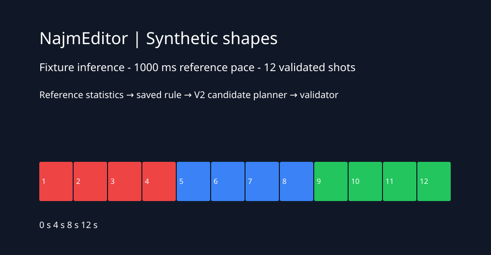
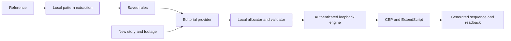

# NajmEditor

**Developer preview — Premiere verification pending.** A local Adobe Premiere Pro automation framework that turns supported patterns from a reference edit into reusable rules, plans a new edit, and applies validated timeline operations through its own CEP panel.

The public example uses original synthetic shapes and deterministic fixture inference. It needs no Premiere, Python, model account, API credentials, personal style files or native templates. It demonstrates **reference → saved pacing rule → actual V2 candidate planner → validated edit plan**.


## Try the offline example

Install Node.js 22 or newer, then:

```sh
npm ci
npm test
npm run demo
```

Expected result: a **2,000 ms** reference pace produces **6 shots**; changing the reference to **1,000 ms** produces **12 shots**. Both plans cover 12 seconds and pass V2 source-range, frame-allocation and continuity validation. See `demo/output/slow/plan.json`, `demo/output/fast/plan.json` and their SVG timelines. Timing/media metadata and inference are explicitly synthetic; this is not a semantic-model benchmark. The synthetic transcript is supplied, not generated by ASR. After dependency installation, these commands make no network requests.



## How it works



The editorial provider chooses story segments, visual candidates and titles. Local code checks bounds, source reuse and timing, then Premiere executes explicit operations. Fixture inference is the default. The optional Codex integration is restricted to synthetic inputs in this preview; it is not enabled merely because an account is signed in.

Reference analysis measures clip durations, cuts, gaps, overlaps, source reuse and track/layer structure. Shot pacing becomes an executable planning rule. Other supported observations can become advisory context. This is pattern extraction and saved rules, not model fine-tuning. Exact typography, animations, effect presets and mixer routing are **not learned or automatically transferred**.

## Premiere integration

The standalone preview uses a separate panel ID and port **47842**, leaving other installations alone. Keep the checkout on disk; the installed panel points to its engine.

```powershell
npm ci
npm run build
powershell.exe -NoProfile -File scripts/install-v2.ps1 -EnableUnsignedCepTestMode
npm start
```

Open **NajmEditor Preview** from Premiere's Extensions menu. The unsigned CEP manifest targets Premiere Pro 2026 (26.x), but **no Premiere version has been live-tested for this public build**. The test-mode switch enables unsigned CEP 12 panels for the current Windows user. No MCP extension is used.

Run `npm run demo:media` to generate original motion footage using FFmpeg. Follow [Premiere acceptance](docs/PREMIERE_ACCEPTANCE.md) to build the synthetic reference/source and apply the same fixture plan through the real host. `scripts/live-smoke.ps1 -ApplySyntheticDemo` uses the current graphics payload and durable target recovery. It does not require a model or ASR. Final video export is manual.

General audio workflows additionally require FFmpeg/ffprobe and a separately installed Python environment with Whisper, Torch and Pillow. Pin its absolute interpreter using `-PythonExecutable` on the installer; Najm never selects Python from PATH. Model weights must already be cached. `npm run test:media` is a separate integration check.

## Verification and limits

Credential-free tests cover pacing-driven planning, validation, authenticated HTTP/WebSocket sessions, partial writes, host restart, duplicate prevention, manual-edit conflicts, and graphics tracks on one-, two- and five-track sources. These use a simulated host, not Adobe Premiere.

The engine persists target intent and host ownership receipts, reads actual state before replaying uncertain writes, and fills missing placements without clearing graphics tracks. Ambiguous ownership or conflicting manual edits stop recovery. Cancellation cannot undo a host operation already executing. Structural completion is recorded separately from visual acceptance.

Local verification: Windows, Node.js 24.15.0; synthetic media and system-font Arabic raster preview. Live Premiere shaping, insertion, track-append behavior and restart recovery remain pending. Native MOGRT mode is optional, requires user-owned files, and has not been verified in this release. No fonts, MOGRTs, private presets, recordings, private profiles or prior project history are included.

See [provider/data boundaries](docs/PROVIDERS.md), [verification](docs/VERIFICATION.md), [security](SECURITY.md), and [third-party notices](THIRD_PARTY_NOTICES.md). A project license has **not** been selected; third-party licenses apply only to their respective components.
